# API REST — Gerenciamento de Chamados de Suporte Técnico

API REST desenvolvida em **Java 21 + Spring Boot** para gerenciar chamados de suporte técnico
(computadores, impressoras, redes e contas de acesso). Os dados ficam em memória.

---

## 1. Tecnologias

- **Java 21**
- **Spring Boot 3.4.1** (`spring-boot-starter-web`)
- **Maven** (build)
- **Jackson** (conversão Java ↔ JSON)
- **Tomcat embutido** (servidor HTTP)

---

## 2. Pré-requisitos

- JDK 17 ou superior (testado com JDK 21).
- Maven 3.9+ (testado com Maven 3.10).

---

## 3. Como executar

Na raiz do projeto (`chamados-api`):

```bash
mvn spring-boot:run
```

Ou, para gerar o `.jar` e executá-lo:

```bash
mvn clean package
java -jar target/chamados-api-1.0.0.jar
```

A aplicação sobe em `http://localhost:8080`.

---

## 4. Estrutura do projeto

```
chamados-api
├── pom.xml
└── src/main
    ├── java/com/empresa/chamados
    │   ├── ChamadosApiApplication.java        # classe principal
    │   ├── controller
    │   │   └── ChamadoController.java         # endpoints REST + dados em memória
    │   └── model
    │       ├── Chamado.java                   # entidade do chamado
    │       ├── Prioridade.java                # BAIXA, MEDIA, ALTA
    │       ├── Status.java                    # ABERTO, EM_ANDAMENTO, RESOLVIDO
    │       └── ResumoStatus.java              # DTO do resumo por status
    └── resources
        └── application.properties
```

---

## 5. Modelo de dados

Cada chamado possui:

| Campo        | Tipo       | Valores possíveis                              |
|--------------|------------|------------------------------------------------|
| `id`         | `Long`     | identificador único (gerado automaticamente)    |
| `titulo`     | `String`   | descrição resumida                              |
| `solicitante`| `String`   | pessoa que abriu o chamado                      |
| `setor`      | `String`   | departamento de origem                          |
| `prioridade` | `enum`     | `BAIXA`, `MEDIA`, `ALTA`                        |
| `status`     | `enum`     | `ABERTO`, `EM_ANDAMENTO`, `RESOLVIDO`           |

---

## 6. Endpoints

| Método | Endpoint                                | Descrição                                                        |
|--------|-----------------------------------------|------------------------------------------------------------------|
| GET    | `/chamados`                             | Lista todos os chamados                                          |
| GET    | `/chamados/{id}`                        | Consulta um chamado pelo ID                                      |
| GET    | `/chamados/setor?nome=financeiro`       | Filtra por setor                                                 |
| GET    | `/chamados/prioridade?nivel=alta`       | Filtra por prioridade                                            |
| GET    | `/chamados/busca?texto=impressora`      | Busca pelo título                                                |
| GET    | `/chamados/criticos`                    | Chamados de prioridade ALTA ainda não resolvidos                 |
| GET    | `/chamados/resumo`                      | Quantidades por status + total                                   |
| POST   | `/chamados`                             | Cadastra um novo chamado (retorna **HTTP 201** + ID gerado)      |

 
- Buscas textuais **não diferenciam maiúsculas de minúsculas**.
- `/chamados/criticos` combina **prioridade + status** (`ALTA` e `!= RESOLVIDO`).
- `/chamados/resumo` retorna JSON com `abertos`, `emAndamento`, `resolvidos` e `total`.
- O `POST` recebe JSON, gera um **ID único sequencial** e devolve **201 Created**.

---

## 7. Dados iniciais (10 chamados fictícios)

| ID | Título                                  | Solicitante     | Setor          | Prioridade | Status        |
|----|-----------------------------------------|-----------------|----------------|------------|---------------|
| 1  | Computador não liga                     | João Silva      | TI             | ALTA       | ABERTO        |
| 2  | Impressora sem toner                    | Maria Souza     | Financeiro     | MEDIA      | ABERTO        |
| 3  | Rede wifi instável                      | Pedro Santos    | TI             | ALTA       | EM_ANDAMENTO  |
| 4  | Acesso bloqueado ao sistema             | Ana Lima        | RH             | ALTA       | ABERTO        |
| 5  | Atualização de software                 | Carlos Pereira  | Comercial      | BAIXA      | RESOLVIDO     |
| 6  | Troca de mouse com defeito              | Fernanda Costa  | Operações      | BAIXA      | RESOLVIDO     |
| 7  | Configuração de e-mail                  | Ricardo Alves   | Financeiro     | MEDIA      | EM_ANDAMENTO  |
| 8  | Impressora não imprime frente e verso   | Juliana Rocha   | Administrativo | MEDIA      | ABERTO        |
| 9  | Reset de senha do ERP                   | Marcos Oliveira | Vendas         | ALTA       | RESOLVIDO     |
| 10 | Instalação de impressora nova           | Beatriz Mendes  | RH             | BAIXA      | EM_ANDAMENTO  |

---

## 8. Testes e demonstração

Foram executadas **11 requisições** reais contra a API em execução. Para reproduzir, inicie a
aplicação (seção 3) e use `curl` ou um cliente HTTP (Postman/Insomnia).

### Teste 1 — Listar todos os chamados

**Requisição:**
```http
GET /chamados
```

**Resposta:** `HTTP 200`
```json
[
  { "id": 1,  "titulo": "Computador não liga",                   "solicitante": "João Silva",     "setor": "TI",            "prioridade": "ALTA",  "status": "ABERTO" },
  { "id": 2,  "titulo": "Impressora sem toner",                  "solicitante": "Maria Souza",    "setor": "Financeiro",    "prioridade": "MEDIA", "status": "ABERTO" },
  { "id": 3,  "titulo": "Rede wifi instável",                    "solicitante": "Pedro Santos",   "setor": "TI",            "prioridade": "ALTA",  "status": "EM_ANDAMENTO" },
  { "id": 4,  "titulo": "Acesso bloqueado ao sistema",           "solicitante": "Ana Lima",       "setor": "RH",            "prioridade": "ALTA",  "status": "ABERTO" },
  { "id": 5,  "titulo": "Atualização de software",               "solicitante": "Carlos Pereira", "setor": "Comercial",     "prioridade": "BAIXA", "status": "RESOLVIDO" },
  { "id": 6,  "titulo": "Troca de mouse com defeito",            "solicitante": "Fernanda Costa", "setor": "Operações",     "prioridade": "BAIXA", "status": "RESOLVIDO" },
  { "id": 7,  "titulo": "Configuração de e-mail",                "solicitante": "Ricardo Alves",  "setor": "Financeiro",    "prioridade": "MEDIA", "status": "EM_ANDAMENTO" },
  { "id": 8,  "titulo": "Impressora não imprime frente e verso", "solicitante": "Juliana Rocha",  "setor": "Administrativo","prioridade": "MEDIA", "status": "ABERTO" },
  { "id": 9,  "titulo": "Reset de senha do ERP",                 "solicitante": "Marcos Oliveira","setor": "Vendas",        "prioridade": "ALTA",  "status": "RESOLVIDO" },
  { "id": 10, "titulo": "Instalação de impressora nova",         "solicitante": "Beatriz Mendes", "setor": "RH",            "prioridade": "BAIXA", "status": "EM_ANDAMENTO" }
]
```
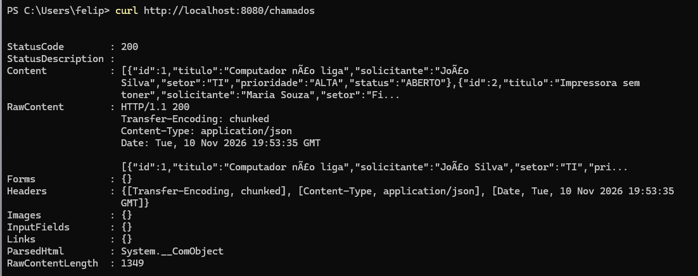


**Explicação:** retorna os 10 chamados iniciais carregados em memória, em ordem de ID.

---

### Teste 2 — Consultar chamado por ID

**Requisição:**
```http
GET /chamados/3
```

**Resposta:** `HTTP 200`
```json
{
  "id": 3,
  "titulo": "Rede wifi instável",
  "solicitante": "Pedro Santos",
  "setor": "TI",
  "prioridade": "ALTA",
  "status": "EM_ANDAMENTO"
}
```
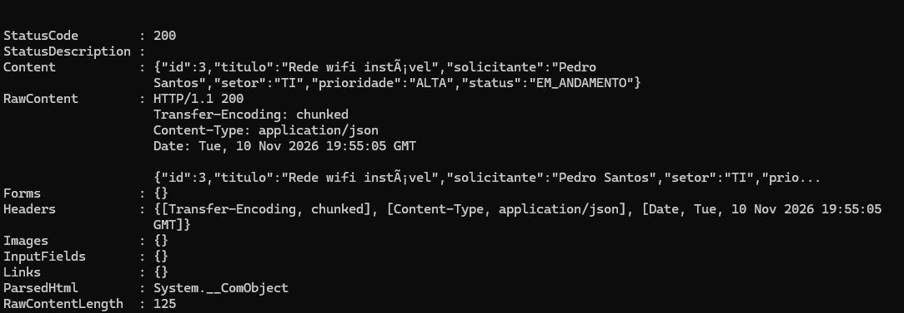
**Explicação:** consulta por identificador retorna um único chamado.

---

### Teste 3 — Filtrar por setor

**Requisição:**
```http
GET /chamados/setor?nome=financeiro
```

**Resposta:** `HTTP 200`
```json
[
  { "id": 2, "titulo": "Impressora sem toner",     "solicitante": "Maria Souza",   "setor": "Financeiro", "prioridade": "MEDIA", "status": "ABERTO" },
  { "id": 7, "titulo": "Configuração de e-mail",   "solicitante": "Ricardo Alves", "setor": "Financeiro", "prioridade": "MEDIA", "status": "EM_ANDAMENTO" }
]
```
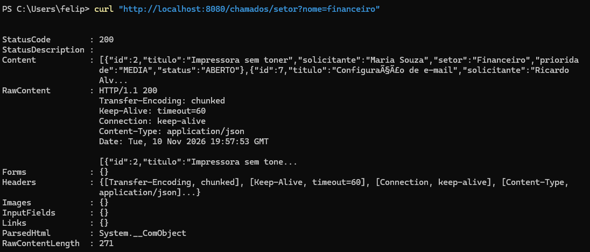
**Explicação:** o filtro é **case-insensitive** — `financeiro` (minúsculo) encontrou o setor
armazenado como `Financeiro`, retornando os 2 chamados do setor.

---

### Teste 4 — Filtrar por prioridade

**Requisição:**
```http
GET /chamados/prioridade?nivel=alta
```

**Resposta:** `HTTP 200`
```json
[
  { "id": 1, "titulo": "Computador não liga",           "solicitante": "João Silva",     "setor": "TI",     "prioridade": "ALTA", "status": "ABERTO" },
  { "id": 3, "titulo": "Rede wifi instável",            "solicitante": "Pedro Santos",    "setor": "TI",     "prioridade": "ALTA", "status": "EM_ANDAMENTO" },
  { "id": 4, "titulo": "Acesso bloqueado ao sistema",   "solicitante": "Ana Lima",        "setor": "RH",     "prioridade": "ALTA", "status": "ABERTO" },
  { "id": 9, "titulo": "Reset de senha do ERP",         "solicitante": "Marcos Oliveira", "setor": "Vendas", "prioridade": "ALTA", "status": "RESOLVIDO" }
]
```
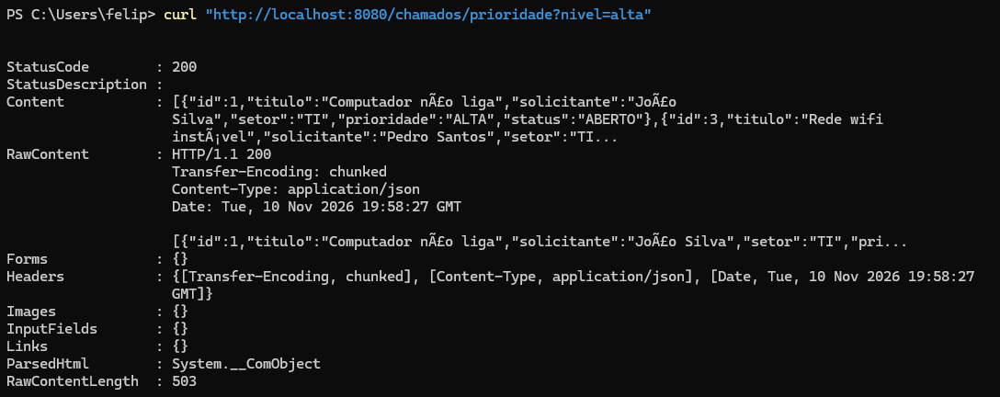
**Explicação:** `nivel=alta` (minúsculo) é convertido para o enum `ALTA`, retornando os 4
chamados de alta prioridade, independentemente do status.

---

### Teste 5 — Buscar pelo título

**Requisição:**
```http
GET /chamados/busca?texto=impressora
```

**Resposta:** `HTTP 200`
```json
[
  { "id": 2,  "titulo": "Impressora sem toner",                  "solicitante": "Maria Souza",   "setor": "Financeiro",    "prioridade": "MEDIA", "status": "ABERTO" },
  { "id": 8,  "titulo": "Impressora não imprime frente e verso", "solicitante": "Juliana Rocha", "setor": "Administrativo","prioridade": "MEDIA", "status": "ABERTO" },
  { "id": 10, "titulo": "Instalação de impressora nova",         "solicitante": "Beatriz Mendes","setor": "RH",            "prioridade": "BAIXA", "status": "EM_ANDAMENTO" }
]
```
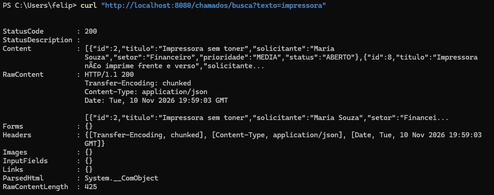
**Explicação:** busca parcial e case-insensitive por `impressora` no título, retornando 3 chamados
que contêm a palavra (inclusive "Instalação de impressora nova").

---

### Teste 6 — Chamados críticos

**Requisição:**
```http
GET /chamados/criticos
```

**Resposta:** `HTTP 200`
```json
[
  { "id": 1, "titulo": "Computador não liga",         "solicitante": "João Silva",  "setor": "TI", "prioridade": "ALTA", "status": "ABERTO" },
  { "id": 3, "titulo": "Rede wifi instável",          "solicitante": "Pedro Santos", "setor": "TI", "prioridade": "ALTA", "status": "EM_ANDAMENTO" },
  { "id": 4, "titulo": "Acesso bloqueado ao sistema", "solicitante": "Ana Lima",     "setor": "RH", "prioridade": "ALTA", "status": "ABERTO" }
]
```
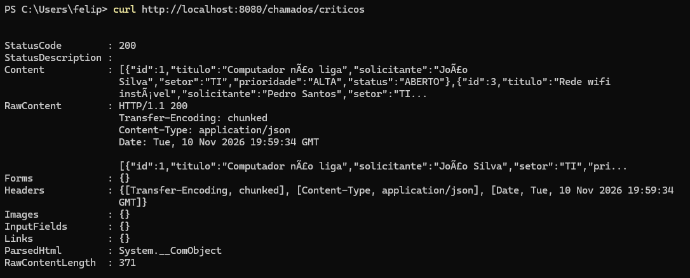
**Explicação:** combina os dois critérios — `prioridade == ALTA` **e** `status != RESOLVIDO`.
O chamado 9 (ALTA, mas RESOLVIDO) foi corretamente excluído.

---

### Teste 7 — Resumo por status

**Requisição:**
```http
GET /chamados/resumo
```

**Resposta:** `HTTP 200`
```json
{
  "abertos": 4,
  "emAndamento": 3,
  "resolvidos": 3,
  "total": 10
}
```
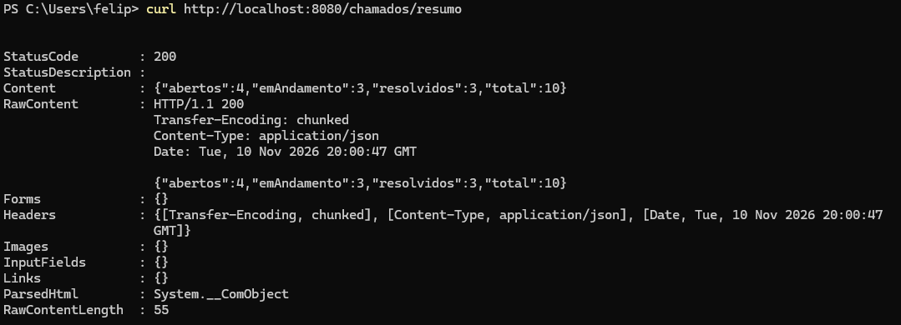
**Explicação:** contabiliza os 10 chamados iniciais — 4 abertos, 3 em andamento, 3 resolvidos,
total 10.

---

### Teste 8 — Busca sem correspondência

**Requisição:**
```http
GET /chamados/busca?texto=projetor
```

**Resposta:** `HTTP 200`
```json
[]
```
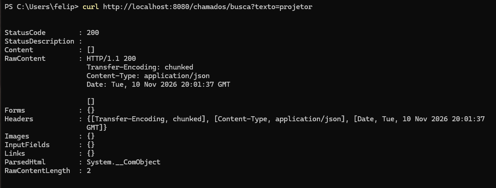
**Explicação:** nenhum título contém "projetor"; a API devolve uma lista vazia (HTTP 200).

---

### Teste 9 — ID inexistente

**Requisição:**
```http
GET /chamados/999
```

**Resposta:** `HTTP 404`
```json
{
  "erro": "Chamado não encontrado."
}
```
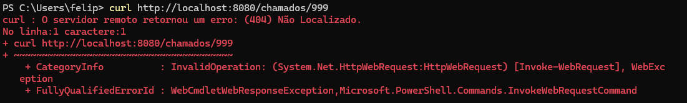
**Explicação:** situação sem correspondência por ID retorna **404 Not Found** com mensagem.

---

### Teste 10 — Cadastrar novo chamado

**Requisição:**
```http
POST /chamados
Content-Type: application/json
```
```json
{
  "titulo": "Impressora do RH sem conexão",
  "solicitante": "Lucas Ferreira",
  "setor": "RH",
  "prioridade": "ALTA",
  "status": "ABERTO"
}
```

**Resposta:** `HTTP 201 Created`
```json
{
  "id": 11,
  "titulo": "Impressora do RH sem conexão",
  "solicitante": "Lucas Ferreira",
  "setor": "RH",
  "prioridade": "ALTA",
  "status": "ABERTO"
}
```
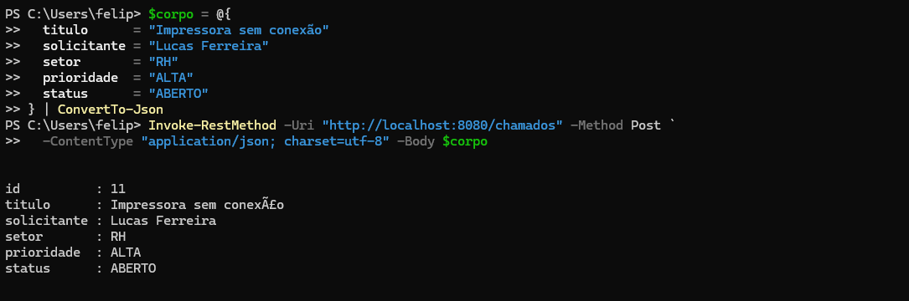
**Explicação:** o JSON é convertido em objeto `Chamado`, um **ID único (11)** é gerado
automaticamente e a resposta é **201 Created** com o objeto criado.

---

### Teste 11 — Verificar o chamado cadastrado

**Requisição:**
```http
GET /chamados/11
```

**Resposta:** `HTTP 200`
```json
{
  "id": 11,
  "titulo": "Impressora do RH sem conexão",
  "solicitante": "Lucas Ferreira",
  "setor": "RH",
  "prioridade": "ALTA",
  "status": "ABERTO"
}
```
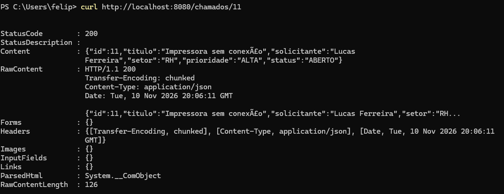
**Explicação:** confirma que o chamado cadastrado no Teste 10 ficou armazenado e pode ser
consultado pelo ID.

---

**Observação**: Os problemas de acentuação que aparecem nas evidências dos testes são relacionados a problemas
de enconding do Windows PowerShell. Os dados são guardados corretamente no servidor, como podemos ver nas imagens abaixo
em que a consulta aos chamados foi feita respectivamente no navegador e no prompt de comando antigo do Windows.
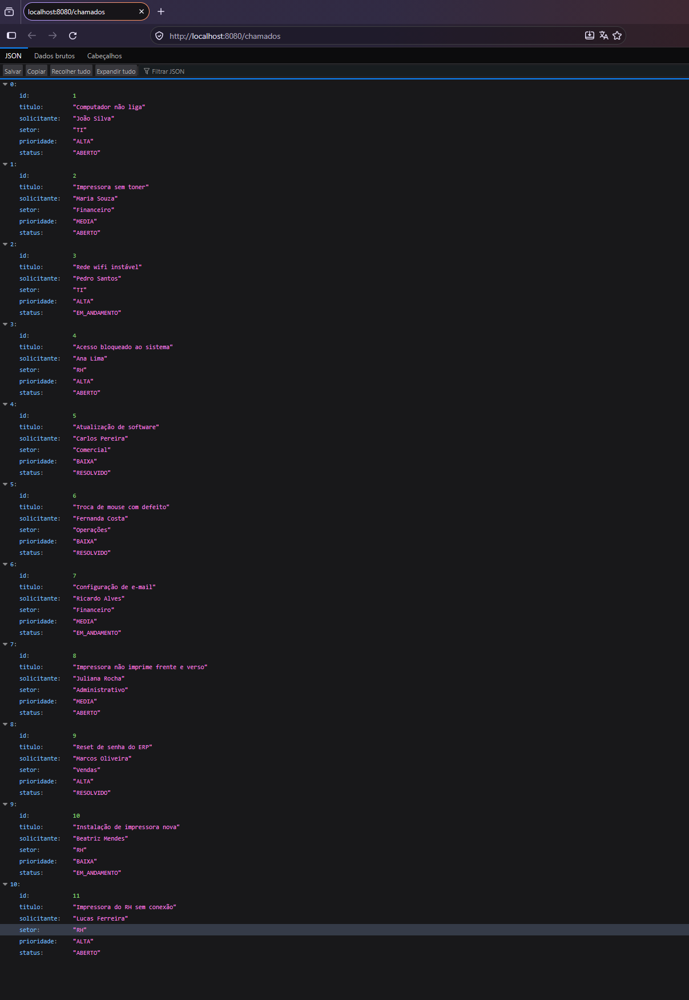
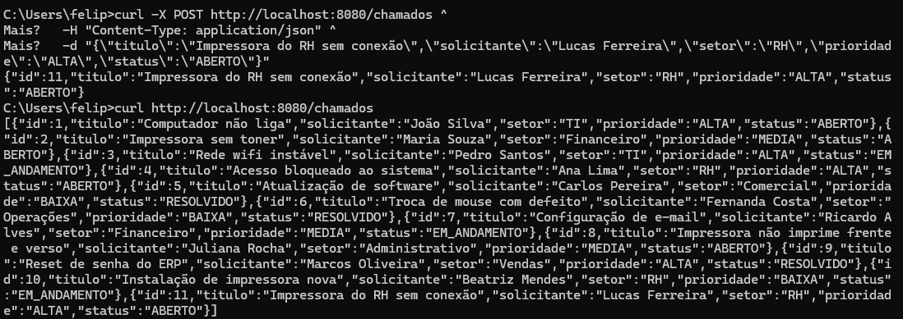
## 9. Explicações

### 9.1 Como o Spring Boot recebe e processa requisições HTTP

O Spring Boot empacota um **servidor HTTP embutido (Tomcat)** por meio do
`spring-boot-starter-web`. Quando a aplicação inicia via `SpringApplication.run(...)`, o Tomcat
sobe e passa a escutar na porta configurada (8080). O fluxo de uma requisição é:

1. **Tomcat** recebe a requisição HTTP e a entrega ao *servlet container* do Spring.
2. O **`DispatcherServlet`** (o front controller do Spring MVC) intercepta a requisição.
3. O `DispatcherServlet` consulta os **`HandlerMapping`**, que comparam a URL e o verbo HTTP com as
   anotações (`@GetMapping`, `@PostMapping`, `@RequestMapping`, `@PathVariable`, `@RequestParam`)
   para descobrir **qual método do Controller** deve ser executado.
4. Um **`HandlerAdapter`** invoca esse método, convertendo os parâmetros da URL/corpo conforme
   necessário.
5. O Controller processa e devolve um valor (objeto Java, `ResponseEntity`, etc.).
6. Na volta, os **`HttpMessageConverter`** transformam o valor de retorno em JSON (ou no formato
   negociado) e o `DispatcherServlet` envia a resposta HTTP de volta ao cliente.

### 9.2 Qual é a função do Controller

O Controller é a camada que **recebe as requisições HTTP e as traduz em chamadas à lógica da
aplicação**, devolvendo uma resposta. Nesta implementação, `ChamadoController`:

- é anotado com `@RestController` (= `@Controller` + `@ResponseBody`), indicando que os retornos
  dos métodos são serializados diretamente no corpo da resposta (JSON);
- mapeia as rotas com `@RequestMapping("/chamados")` no nível da classe e `@GetMapping` /
  `@PostMapping` nos métodos;
- extrai dados da requisição com `@PathVariable` (ex.: `{id}`) e `@RequestParam`
  (ex.: `nome`, `nivel`, `texto`);
- recebe o corpo JSON com `@RequestBody`;
- mantém a lista de chamados em memória e aplica as regras de filtro/busca;
- define o status HTTP da resposta (200, 201, 400, 404) via `ResponseEntity`.


### 9.3 Como ocorre a conversão entre objetos Java e JSON

A conversão é feita pela biblioteca **Jackson**, integrada pelo Spring através da interface
**`HttpMessageConverter`** (a implementação `MappingJackson2HttpMessageConverter` é registrada
automaticamente pelo Spring Boot).

- **Entrada (JSON → Java):** no `@RequestBody Chamado novo`, o Spring lê o corpo da requisição e o
  `ObjectMapper` do Jackson o converte em uma instância de `Chamado` (desserialização), usando o
  construtor vazio e os *setters*. Enums como `ALTA` viram constantes de `Prioridade`.
- **Saída (Java → JSON):** com `@ResponseBody`/`@RestController`, o valor retornado pelo método é
  convertido em JSON (serialização) usando os *getters*. Enums viram strings (`"ALTA"`), o
  `record ResumoStatus` vira um objeto com as chaves `abertos`, `emAndamento`, `resolvidos` e
  `total`, e listas viram arrays JSON.

A propriedade `spring.jackson.mapper.accept-case-insensitive-enums=true` no
`application.properties` permite que o JSON de entrada aceite enums em maiúsculas ou minúsculas
(ex.: `"alta"` ou `"ALTA"`).

### 9.4 Por que os chamados cadastrados não permanecem após reiniciar

Os dados são armazenados em uma coleção Java (`ArrayList<Chamado>`), que vive na **memória RAM
(heap) da JVM**. Quando a aplicação é encerrada ou reiniciada, o processo da JVM é finalizado, a
memória é liberada e a lista é destruída. Como não há persistência em banco de dados
nem gravação em arquivo, qualquer chamado criado em tempo de execução se perde. Ao reiniciar, o
construtor do Controller executa novamente e recarrega apenas os 10 chamados iniciais. Para manter
os dados, seria necessário adicionar uma camada de persistência (ex.: Spring Data JPA + banco) ou
serializar a lista em um arquivo/disco.
